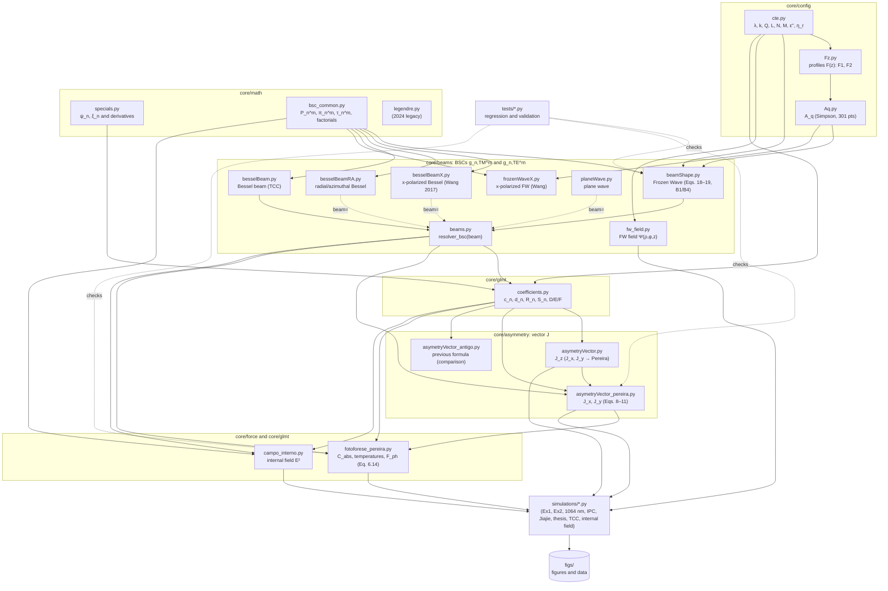
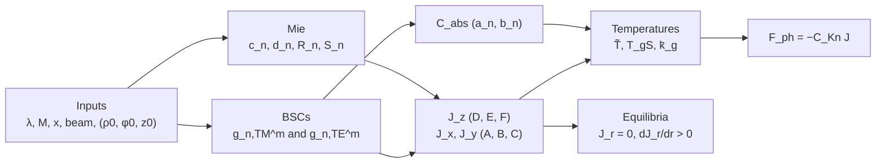

# pytophoretic

**English** | [Português](README.pt-BR.md)

Simulation of the **asymmetry vector** and the **photophoretic force** on spherical particles illuminated by structured beams (Frozen Waves, Bessel beams, plane wave), within the Generalized Lorenz–Mie Theory (GLMT).

Master's research of Beatriz Helena Rocha (EESC/USP, AEG group).

> Code status as of 2026-10-16: the transverse components $`J_x, J_y`$ use the corrected expressions of D. Pereira; $`J_z`$ is unchanged. The Frozen Wave uses corrections B1 ($`\pi_n^m`$) and B4 ($`g`$ term of the TE mode). Equilibrium analysis is done at the particle position $`X=-\rho_0`$.

---

## 1. Conventions

| Item | Convention |
|---|---|
| Time dependence | $`e^{+i\omega t}`$ |
| Relative refractive index | $`M = n - i\kappa`$ ($`\kappa>0`$ absorbs), $`\mu_r`$ relative permeability |
| Permittivity | $`\varepsilon_r = M^2/\mu_r`$, $`\varepsilon'' = -\,\mathrm{Im}(M^2/\mu_r)`$ (`cte.epsilonR2`) |
| Relative impedance | $`\eta_r = \sqrt{\mu_r/\varepsilon_r}`$ (`cte.Eta_r`) |
| Size parameter | $`x = k a = 2\pi a/\lambda`$ |
| Position | $`(\rho_0,\varphi_0)`$ = position of the **beam axis** as seen from the particle. The particle is at $`(X,Y) = -\rho_0(\cos\varphi_0,\sin\varphi_0)`$. |
| Force | $`\mathbf F = -C_{Kn}\,\mathbf J`$ |
| Stable radial equilibrium | $`J_x = 0`$ and $`\partial J_x/\partial X > 0`$ (particle on the $`x`$ axis); in general, $`J_r`$ crosses zero increasing with the distance to the axis |
| Truncation | $`n_{\max} = \lceil x + 4.05\,x^{1/3} + 2\rceil`$ (Wiscombe) |

---

## 2. Beams and beam shape coefficients (BSCs)

### 2.1 Frozen Wave (`fw_field.py`, `Aq.py`, `Fz.py`, `beamShape.py`)

Scalar field of order $`v`$, built from $`2N+1`$ Bessel beams:

```math
\Psi(\rho,\varphi,z) = \sum_{q=-N}^{N} A_q\, J_v(h_q\rho)\, e^{iv\varphi}\, e^{-i\beta_q z},
\qquad
A_q = \frac{1}{L}\int_0^L F(z)\, e^{\,i2\pi q z/L}\,dz,
```

```math
\beta_q = Q + \frac{2\pi q}{L},\qquad
h_q = \sqrt{2}\,k\sqrt{1-\beta_q/k}\ \ (\text{paraxial form of } \sqrt{k^2-\beta_q^2}).
```

- **Coefficients $`A_q`$:** computed with composite Simpson's rule, 301 points on $`[0,L]`$.
- **Propagating beams only:** $`0 \le \beta_q \le k`$, which gives $`N \le \lfloor (k-Q)L/2\pi \rfloor`$.

**Longitudinal profiles** $`F(z)`$ (`Fz.py`):

- **F1** (piecewise polynomial), with $`\ell_1..\ell_6 = L/10,\,3L/10,\,4L/10,\,6L/10,\,7L/10,\,9L/10`$:

```math
F_1(z)=\begin{cases}
-4\,\dfrac{(z-\ell_1)(z-\ell_2)}{(\ell_2-\ell_1)^2}, & \ell_1\le z\le \ell_2\\[4pt]
1, & \ell_3\le z\le \ell_4\\[4pt]
-4\,\dfrac{(z-\ell_5)(z-\ell_6)}{(\ell_6-\ell_5)^2}, & \ell_5\le z\le \ell_6\\[4pt]
0, & \text{otherwise}
\end{cases}
```

- **F2** (modulated Gaussian): $`F_2(z) = e^{-5(z-L/2)^2/L^2}\cos(6\pi z/L)`$ on $`[L/12,\,11L/12]`$.

**FW BSCs** (linear $`x`$ polarization; Eqs. 18–19), with $`\cos\alpha_q = \beta_q/k`$ and the angular functions evaluated at $`\cos\alpha_q`$:

```math
\pi_n^m = \frac{P_n^m(\cos\alpha_q)}{\sin\alpha_q},\qquad
\tau_n^m = \frac{dP_n^m(\cos\alpha)}{d\alpha}\bigg|_{\alpha_q}
= \frac{-(n+1)\cos\alpha_q\,P_n^m + (n-m+1)\,P_{n+1}^m}{\sin\alpha_q}.
```

```math
g^m_{n,TM} = \tfrac12\, i^{m+1}(-1)^{\frac{m-|m|}{2}}\frac{(n-m)!}{(n+|m|)!}
\sum_{q} A_q e^{i\beta_q z_0}
\Big[ \mathcal J^{-}_{q}\big(\tfrac{k}{\beta_q}\tau_n^m + m\pi_n^m\big)
+ \mathcal J^{+}_{q}\big(-\tfrac{k}{\beta_q}\tau_n^m + m\pi_n^m\big)\Big]
```

```math
g^m_{n,TE} = -\tfrac{i}{2}\, i^{m+1}(-1)^{\frac{m-|m|}{2}}\frac{(n-m)!}{(n+|m|)!}
\sum_{q} A_q e^{i\beta_q z_0}
\Big[ \mathcal J^{-}_{q}\big(m\tfrac{k}{\beta_q}\pi_n^m + \tau_n^m\big)
- \mathcal J^{+}_{q}\big(m\tfrac{k}{\beta_q}\pi_n^m - \tau_n^m\big)\Big]
```

```math
\mathcal J^{\mp}_{q} = J_{m-v\mp1}(h_q\rho_0)\, e^{-i(m-v\mp1)\varphi_0}.
```

BSC validation:

- **B1:** the form of $`\pi_n^m`$ above.
- **B4:** the factor $`k/\beta_q`$ multiplies $`m\pi_n^m`$ in both TE brackets.
- **Tests:** `tests/teste_B1_B4_isolado.py` and `tests/regressao_fw.py`.

### 2.2 $`x`$-polarized Bessel beam (`besselBeamX.py`, Wang et al. 2017)

```math
g^m_{n,TM} = -g(\alpha_0)(-1)^{\frac{m-|m|}{2}}\frac{(n-m)!}{(n+|m|)!}e^{ik_z z_0}
\Big\{ i^{l-m+1}e^{i(l-m+1)\varphi_0}J_{l-m+1}(s_0)\,[\tau_n^m + m\pi_n^m]
+ i^{l-m-1}e^{i(l-m-1)\varphi_0}J_{l-m-1}(s_0)\,[\tau_n^m - m\pi_n^m]\Big\}
```

```math
g^m_{n,TE} = i\,g(\alpha_0)(-1)^{\frac{m-|m|}{2}}\frac{(n-m)!}{(n+|m|)!}e^{ik_z z_0}
\Big\{ i^{l-m+1}e^{i(l-m+1)\varphi_0}J_{l-m+1}(s_0)\,[\tau_n^m + m\pi_n^m]
- i^{l-m-1}e^{i(l-m-1)\varphi_0}J_{l-m-1}(s_0)\,[\tau_n^m - m\pi_n^m]\Big\}
```

- $`s_0 = k\sin\alpha_0\,\rho_0`$, $`k_z = k\cos\alpha_0`$, with $`\pi_n^m,\tau_n^m`$ evaluated at $`\cos\alpha_0`$.
- $`g(\alpha_0)=1/2`$ (aplanatic).

### 2.3 Radially (TM) and azimuthally (TE) polarized Bessel beams, $`l=0`$ (`besselBeamRA.py`)

TM mode (radial):

```math
g^m_{n,TM} = -g(-1)^{\frac{m-|m|}{2}}\frac{(n-m)!}{(n+|m|)!}e^{ik_zz_0}\,i^{m-l}J_{m-l}(k_\rho\rho_0)e^{i(l-m)\varphi_0}\,\tau_n^m,
```

```math
g^m_{n,TE} = g(-1)^{\frac{m-|m|}{2}}\frac{(n-m)!}{(n+|m|)!}e^{ik_zz_0}\,i^{m-l+1}J_{m-l}(k_\rho\rho_0)e^{i(l-m)\varphi_0}\,m\pi_n^m.
```

TE mode (azimuthal): $`g_{TM}^{(TE)} = g_{TE}^{(TM)}`$ and $`g_{TE}^{(TE)} = -g_{TM}^{(TM)}`$.

### 2.4 $`x`$-polarized plane wave (`planeWave.py`)

```math
g^{\pm1}_{n,TM} = \pm i\,g^{\pm1}_{n,TE} = \tfrac12 e^{ikz_0},\qquad g^m_{n,TM}=g^m_{n,TE}=0\ \ (|m|\ne1).
```

The beam is selected by `beams.resolver_bsc(beam)`: `beam=None` means the Frozen Wave of `beamShape.py`, and any other object must provide `g_mnTM`/`g_mnTE` methods.

---

## 3. Mie coefficients (`coefficients.py`, `specials.py`)

Riccati–Bessel functions: $`\psi_n(z) = z\,j_n(z)`$ and $`\xi_n(z) = z\,h_n^{(2)}(z)`$; the second kind follows from the $`e^{+i\omega t}`$ convention.

**Internal coefficients:**

```math
c_n = \frac{M\mu_r\,[\xi_n(x)\psi_n'(x) - \xi_n'(x)\psi_n(x)]}{\mu_r\,\xi_n(x)\psi_n'(Mx) - M\,\xi_n'(x)\psi_n(Mx)},
\qquad
d_n = \frac{M^2\,[\xi_n(x)\psi_n'(x) - \xi_n'(x)\psi_n(x)]}{M\,\xi_n(x)\psi_n'(Mx) - \mu_r\,\xi_n'(x)\psi_n(Mx)}.
```

**External coefficients** ($`\mu_r=1`$, used in the cross sections):

```math
a_n = \frac{\psi_n(x)\psi_n'(Mx) - M\psi_n'(x)\psi_n(Mx)}{\xi_n(x)\psi_n'(Mx) - M\xi_n'(x)\psi_n(Mx)},\qquad
b_n = \frac{M\psi_n(x)\psi_n'(Mx) - \psi_n'(x)\psi_n(Mx)}{M\xi_n(x)\psi_n'(Mx) - \xi_n'(x)\psi_n(Mx)}.
```

**Radial functions** of the heat-source integral:

```math
R_n = \frac{\mathrm{Im}\!\left[M\,\psi_{n+1}(Mx)\,\psi_n^*(Mx)\right]}{\mathrm{Im}(M^2)},
```

```math
S_n = -\frac{i}{2\,\mathrm{Im}(M^2)}\Big[x\big(M|\psi_n(Mx)|^2 + M^*|\psi_{n+1}(Mx)|^2\big) - \Big(M + \frac{2(n+1)\mathrm{Re}(M^2)}{M}\Big)R_n + (2n+1)M^*R_{n+1}\Big].
```

---

## 4. Asymmetry vector (`asymetryVector.py`, `asymetryVector_pereira.py`)

Definition:

```math
\mathbf J = \frac{1}{V_p}\int_{V_p} \frac{\mathbf r}{a}\,B(\mathbf r)\,dV,\qquad B = \frac{|\mathbf E|^2}{|E_0|^2}.
```

The code returns $`J_i = \dfrac{3\varepsilon''}{8\pi a^3}\,\mathcal I_i`$.

### 4.1 Longitudinal component (unchanged)

```math
J_z = \frac{6\varepsilon''}{|M|^2x^3}\,\mathrm{Im}\sum_{n=1}^{n_{\max}}\sum_{m=-n}^{n}
\Big[D_n^m\Big(S_n^* + \frac{n+1}{M}R_{n+1}\Big) + E_n^m\Big(-S_n + \frac{n+1}{M}R_n\Big) + iF_n^m S_n\Big]
```

```math
D_n^m = \frac{c_n^*c_{n+1}}{(n+1)^2}\,g^{m*}_{n,TM}\,g^m_{n+1,TM}\frac{(n+|m|+1)!}{(n-|m|)!},\qquad
E_n^m = \frac{|\eta_r|^2\,d_n^*d_{n+1}}{(n+1)^2}\,g^{m*}_{n,TE}\,g^m_{n+1,TE}\frac{(n+|m|+1)!}{(n-|m|)!},
```

```math
F_n^m = m\,\eta_r^*\,\frac{2n+1}{[n(n+1)]^2}\,c_n d_n^*\,g^m_{n,TM}\,g^{m*}_{n,TE}\frac{(n+|m|)!}{(n-|m|)!}.
```

### 4.2 Transverse components (D. Pereira, technical note JxJy_mod, Eqs. 8–11)

```math
J_{x;y} = -\frac{3\varepsilon''}{|M|^2x^3}\,\Big\{\mathrm{Im};\mathrm{Re}\Big\}\sum_{n=1}^{n_{\max}}
\Big[A_n\Big(S_n^* + \frac{n+1}{M}R_{n+1}\Big) + B_n\Big(-S_n + \frac{n+1}{M}R_n\Big) - iC_nS_n\Big]
```

```math
\begin{aligned}
A_n = \frac{c_n^*c_{n+1}}{(n+1)^2}\Big\{
&\mp\sum_{m=0}^{n-1} g^{m+1*}_{n,TM}g^{m}_{n+1,TM}\frac{(n+m+1)!}{(n-m-1)!}
+\sum_{m=0}^{n} g^{m*}_{n,TM}g^{m+1}_{n+1,TM}\frac{(n+m+2)!}{(n-m)!}\\
&\pm\sum_{m=-n-1}^{-1} g^{m+1*}_{n,TM}g^{m}_{n+1,TM}\frac{(n+|m|+1)!}{(n-|m|+1)!}
-\sum_{m=-n}^{-1} g^{m*}_{n,TM}g^{m+1}_{n+1,TM}\frac{(n+|m|)!}{(n-|m|)!}\Big\}
\end{aligned}
```

$`B_n`$: same as $`A_n`$ with $`c_n\to d_n`$, TM → TE and prefactor $`|\eta_r|^2/(n+1)^2`$.

```math
C_n = \frac{2n+1}{[n(n+1)]^2}\,\eta_r^*\,c_nd_n^*\Big\{\sum_{m=0}^{n-1}\big(g^{m+1}_{n,TM}g^{m*}_{n,TE} \pm g^{m}_{n,TM}g^{m+1*}_{n,TE}\big)\frac{(n+m+1)!}{(n-m-1)!}
-\sum_{m=-n}^{-1}(\cdots)\frac{(n+|m|)!}{(n-|m|)!}\Big\}
```

The upper sign applies to $`J_x`$ and the lower sign to $`J_y`$. The previous formulation (Ambrosio 2022, Eqs. 30a–31) is frozen in `asymetryVector_antigo.py`, for comparison only.

### 4.3 Radial and transverse components

For the particle at $`\theta = \varphi_0 + \pi`$:

```math
J_r = J_x\cos\theta + J_y\sin\theta,\qquad J_\varphi = -J_x\sin\theta + J_y\cos\theta.
```

- On the $`x`$ axis: $`J_r = \pm J_x`$ and $`J_\varphi = \pm J_y`$, so $`J_y`$ is orbital.
- On the $`y`$ axis: $`J_r = \pm J_y`$.

---

## 5. Photophoretic force (`fotoforese_pereira.py`)

Generalized modified Loesche–Husmann model (D. Pereira, thesis, Eq. 6.14):

```math
\mathbf F_{ph} = -4\pi f_{pc}(T^*)\,\mu_g(T_\infty)\left[\frac{\mu_g(T_{gS})}{\rho_g(T_{gS})\,T_{gS}}\,\frac{K_S + 3K_hK_m\mathrm{Kn}}{1+3K_m\mathrm{Kn}}\right]
\frac{1}{1+2K_T\mathrm{Kn}}\;
\frac{I_\lambda\,\mathbf J}{\dfrac{k_p}{R_p} + \dfrac{\bar k_g}{R_p}\dfrac{2}{1+2K_T\mathrm{Kn}} + 4\sigma\epsilon\tilde T^3}
```

**Quantities:**

- **Knudsen number:** $`\mathrm{Kn} = \ell/R_p`$.
- **Slip coefficients** (Table 2.1): $`K_S = 1.152`$, $`K_T = 2.179`$, $`K_m = 1.131`$, $`K_h`$ adjustable (1 is used).
- **Prefactor:** $`1/(1+2K_T\mathrm{Kn})`$, from the original L–H model; the thesis prints $`1/(2+2K_T\mathrm{Kn})`$. Confirmation with D. Pereira is pending.
- **Correction factor:** $`f_{pc}(T^*) = -0.0171\,T^{*2} + 0.2851\,T^* + 0.7327`$, with $`T^* = T_{gS}/T_\infty`$ (air).

**Absorption** (Eq. 6.15):

```math
J_0I_0 = \frac{C_{abs}\,I_\lambda}{4\pi R_p^2}.
```

**Temperatures** (Eqs. 5.3, 5.5, 5.6): $`\tilde T = T_{pS}`$, $`T_{gS}`$ and $`\bar k_g`$ are solved in a fixed-point loop, tolerance $`10^{-10}`$.

**GLMT cross sections** (Eqs. 6.16–6.17), with $`C_{abs} = C_{ext} - C_{sca}`$:

```math
C_{ext} = \frac{\lambda^2}{\pi}\sum_{n}\frac{2n+1}{n(n+1)}\sum_{m}\frac{(n+|m|)!}{(n-|m|)!}\,\mathrm{Re}\big(a_n|g^m_{n,TM}|^2 + b_n|g^m_{n,TE}|^2\big)
```

```math
C_{sca} = \frac{\lambda^2}{\pi}\sum_{n}\frac{2n+1}{n(n+1)}\sum_{m}\frac{(n+|m|)!}{(n-|m|)!}\big(|a_n|^2|g^m_{n,TM}|^2 + |b_n|^2|g^m_{n,TE}|^2\big)
```

**Weight:** $`mg = \rho_p\,\tfrac43\pi R_p^3\,g`$.

---

## 6. Internal field (`campo_interno.py`)

$`|\mathbf E(r,\theta,\varphi)|^2/|E_0|^2`$ inside the particle, from the vector spherical wave expansion with the internal coefficients $`c_n, d_n`$ and the beam's BSCs. This is the source function $`B(\mathbf r)`$ that produces the heating asymmetry, following Figs. 2–3 of Ambrosio 2020.

---

## 7. Code organization



### Computing one point (typical flow)



### Folders

| Folder | Contents | Tracked in git? |
|---|---|---|
| `core/config/` | `cte.py`, `Fz.py`, `Aq.py`: constants, $`F(z)`$ profiles, $`A_q`$ | yes |
| `core/math/` | `specials.py`, `bsc_common.py`, `legendre.py`: Riccati–Bessel, $`P_n^m`$, $`\pi_n^m`$, $`\tau_n^m`$ | yes |
| `core/beams/` | `beamShape.py`, `fw_field.py`, `frozenWaveX.py`, `besselBeam*.py`, `planeWave.py`, `beams.py`: BSCs of each beam | yes |
| `core/glmt/` | `coefficients.py`, `campo_interno.py`: Mie coefficients and internal field | yes |
| `core/asymmetry/` | `asymetryVector.py`, `asymetryVector_pereira.py`, `asymetryVector_antigo.py` | yes |
| `core/force/` | `fotoforese_pereira.py` | yes |
| `simulations/` | one script per simulation (`simulations/legacy/`: previous formulation) | no |
| `tests/` | regression and validation | no |
| `figs/` | generated figures and data | no |
| `reports/` | reports, constants and the simulation index (`reports/INDICE_SIMULACOES.md`) | no |
| `legacy/`, `_archive/` | legacy code, backups and history | no |

To find out what each simulation studies, which script produces it and whether the result is still valid, see `reports/INDICE_SIMULACOES.md` (in Portuguese).

### Importing the core modules

`core/__init__.py` only adds its sub-folders to `sys.path`; every module keeps its short name. A script in `simulations/` or `tests/` starts with:

```python
import os, sys
sys.path.insert(0, os.path.dirname(os.path.dirname(os.path.abspath(__file__))))  # repository root
import core                     # adds core/config, core/math, core/beams, ... to sys.path
import beamShape, cte           # short names, as before
from asymetryVector_pereira import I_xy
```

`import core` does not import any module, so scripts that redefine `cte` before importing the beam modules (`simulations/fw1064_comum.py`, `simulations/ipc2024.py`) keep working.

---

## 8. Quick checks

- `python tests/regressao_fw.py`: should print `REGRESSAO OK` (bit-for-bit check of the FW BSCs and of $`J`$).
- `python tests/verificacao_fw1064.py`: FW at 1064 nm and regression at 514 nm.
- `python tests/verificacao_sinal_Ix.py`: sign convention and geometry of $`J_x`$.

## 9. Dependencies

See `requirements.txt` (numpy, scipy, matplotlib, mpmath, numba, sympy, torch).

## 10. Main references

- L. A. Ambrosio et al. (2022): GLMT, asymmetry vector and plane-wave BSCs; Ambrosio (2020), internal field.
- D. J. S. Pereira, technical note JxJy_mod (Oct. 2025) and thesis "3D Photophoresis in Slip-flow" (Univ. Coimbra, 2026).
- J. J. Wang et al., Opt. Commun. 387, 102 (2017): Bessel beam BSCs.
- Sun (Jiajie) et al., Appl. Opt. 61, 7632 (2022): photophoretic force with Bessel beams.
- B. H. Rocha, de Sarro & Ambrosio, IPC 2024: asymmetry vector with Frozen Waves.
