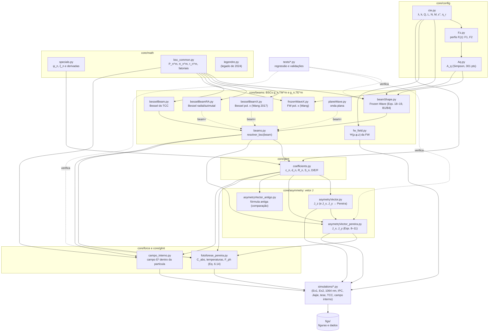
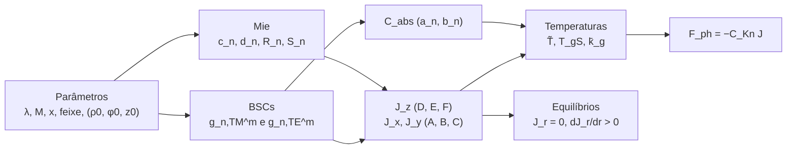

# pytophoretic

[English](README.md) | **Português**

Simulação do **vetor de assimetria** e da **força fotoforética** sobre partículas esféricas iluminadas por feixes estruturados (Frozen Waves, feixes de Bessel, onda plana), pela Teoria Generalizada de Lorenz–Mie (GLMT).

Mestrado de Beatriz Helena Rocha (EESC/USP, grupo AEG).

> Estado do código em 16/10/2026: componentes transversais $`J_x, J_y`$ pelas expressões corrigidas de D. Pereira; $`J_z`$ inalterado. A Frozen Wave usa as correções B1 ($`\pi_n^m`$) e B4 (termo $`g`$ do modo TE). A análise de equilíbrio é feita na posição da partícula $`X=-\rho_0`$.

---

## 1. Convenções

| Item | Convenção |
|---|---|
| Dependência temporal | $`e^{+i\omega t}`$ |
| Índice relativo | $`M = n - i\kappa`$ ($`\kappa>0`$ absorve), $`\mu_r`$ permeabilidade relativa |
| Permissividade | $`\varepsilon_r = M^2/\mu_r`$, $`\varepsilon'' = -\,\mathrm{Im}(M^2/\mu_r)`$ (`cte.epsilonR2`) |
| Impedância relativa | $`\eta_r = \sqrt{\mu_r/\varepsilon_r}`$ (`cte.Eta_r`) |
| Parâmetro de tamanho | $`x = k a = 2\pi a/\lambda`$ |
| Posição | $`(\rho_0,\varphi_0)`$ = posição do **eixo do feixe** vista da partícula. A partícula está em $`(X,Y) = -\rho_0(\cos\varphi_0,\sin\varphi_0)`$. |
| Força | $`\mathbf F = -C_{Kn}\,\mathbf J`$ |
| Equilíbrio radial estável | $`J_x = 0`$ e $`\partial J_x/\partial X > 0`$ (partícula sobre o eixo $`x`$); em geral, $`J_r`$ cruza zero crescendo com a distância ao eixo |
| Truncamento | $`n_{\max} = \lceil x + 4{,}05\,x^{1/3} + 2\rceil`$ (Wiscombe) |

---

## 2. Feixes e coeficientes de forma (BSCs)

### 2.1 Frozen Wave (`fw_field.py`, `Aq.py`, `Fz.py`, `beamShape.py`)

Campo escalar de ordem $`v`$, com $`2N+1`$ feixes de Bessel:

```math
\Psi(\rho,\varphi,z) = \sum_{q=-N}^{N} A_q\, J_v(h_q\rho)\, e^{iv\varphi}\, e^{-i\beta_q z},
\qquad
A_q = \frac{1}{L}\int_0^L F(z)\, e^{\,i2\pi q z/L}\,dz,
```

```math
\beta_q = Q + \frac{2\pi q}{L},\qquad
h_q = \sqrt{2}\,k\sqrt{1-\beta_q/k}\ \ (\text{forma paraxial de } \sqrt{k^2-\beta_q^2}).
```

- **Coeficientes $`A_q`$:** calculados por Simpson composto com 301 pontos em $`[0,L]`$.
- **Feixes propagantes:** exige-se $`0 \le \beta_q \le k`$, o que dá $`N \le \lfloor (k-Q)L/2\pi \rfloor`$.

**Perfis longitudinais** $`F(z)`$ (`Fz.py`):

- **F1** (polinomial por partes), com $`\ell_1..\ell_6 = L/10,\,3L/10,\,4L/10,\,6L/10,\,7L/10,\,9L/10`$:

```math
F_1(z)=\begin{cases}
-4\,\dfrac{(z-\ell_1)(z-\ell_2)}{(\ell_2-\ell_1)^2}, & \ell_1\le z\le \ell_2\\[4pt]
1, & \ell_3\le z\le \ell_4\\[4pt]
-4\,\dfrac{(z-\ell_5)(z-\ell_6)}{(\ell_6-\ell_5)^2}, & \ell_5\le z\le \ell_6\\[4pt]
0, & \text{fora}
\end{cases}
```

- **F2** (gaussiana modulada): $`F_2(z) = e^{-5(z-L/2)^2/L^2}\cos(6\pi z/L)`$ em $`[L/12,\,11L/12]`$.

**BSCs da FW** (polarização linear em $`x`$; Eqs. 18–19), com $`\cos\alpha_q = \beta_q/k`$ e as funções angulares avaliadas em $`\cos\alpha_q`$:

```math
\pi_n^m = \frac{P_n^m(\cos\alpha_q)}{\sin\alpha_q},\qquad
\tau_n^m = \frac{dP_n^m(\cos\alpha)}{d\alpha}\bigg|_{\alpha_q}
= \frac{-(n+1)\cos\alpha_q\,P_n^m + (n-m+1)\,P_{n+1}^m}{\sin\alpha_q}.
```

```math
g^m_{n,TM} = \tfrac12\, i^{m+1}(-1)^{\frac{m-|m|}{2}}\frac{(n-m)!}{(n+|m|)!}
\sum_{q} A_q e^{i\beta_q z_0}
\Big[ \mathcal J^{-}_{q}\big(\tfrac{k}{\beta_q}\tau_n^m + m\pi_n^m\big)
+ \mathcal J^{+}_{q}\big(-\tfrac{k}{\beta_q}\tau_n^m + m\pi_n^m\big)\Big]
```

```math
g^m_{n,TE} = -\tfrac{i}{2}\, i^{m+1}(-1)^{\frac{m-|m|}{2}}\frac{(n-m)!}{(n+|m|)!}
\sum_{q} A_q e^{i\beta_q z_0}
\Big[ \mathcal J^{-}_{q}\big(m\tfrac{k}{\beta_q}\pi_n^m + \tau_n^m\big)
- \mathcal J^{+}_{q}\big(m\tfrac{k}{\beta_q}\pi_n^m - \tau_n^m\big)\Big]
```

```math
\mathcal J^{\mp}_{q} = J_{m-v\mp1}(h_q\rho_0)\, e^{-i(m-v\mp1)\varphi_0}.
```

Validação dos BSCs:

- **B1:** a forma de $`\pi_n^m`$ acima.
- **B4:** o fator $`k/\beta_q`$ multiplica $`m\pi_n^m`$ nos dois colchetes do TE.
- **Testes:** `tests/teste_B1_B4_isolado.py` e `tests/regressao_fw.py`.

### 2.2 Feixe de Bessel polarizado em $`x`$ (`besselBeamX.py`, Wang et al. 2017)

```math
g^m_{n,TM} = -g(\alpha_0)(-1)^{\frac{m-|m|}{2}}\frac{(n-m)!}{(n+|m|)!}e^{ik_z z_0}
\Big\{ i^{l-m+1}e^{i(l-m+1)\varphi_0}J_{l-m+1}(s_0)\,[\tau_n^m + m\pi_n^m]
+ i^{l-m-1}e^{i(l-m-1)\varphi_0}J_{l-m-1}(s_0)\,[\tau_n^m - m\pi_n^m]\Big\}
```

```math
g^m_{n,TE} = i\,g(\alpha_0)(-1)^{\frac{m-|m|}{2}}\frac{(n-m)!}{(n+|m|)!}e^{ik_z z_0}
\Big\{ i^{l-m+1}e^{i(l-m+1)\varphi_0}J_{l-m+1}(s_0)\,[\tau_n^m + m\pi_n^m]
- i^{l-m-1}e^{i(l-m-1)\varphi_0}J_{l-m-1}(s_0)\,[\tau_n^m - m\pi_n^m]\Big\}
```

- $`s_0 = k\sin\alpha_0\,\rho_0`$, $`k_z = k\cos\alpha_0`$, e $`\pi_n^m,\tau_n^m`$ avaliados em $`\cos\alpha_0`$.
- $`g(\alpha_0)=1/2`$ (aplanático).

### 2.3 Feixe de Bessel radial (TM) e azimutal (TE), $`l=0`$ (`besselBeamRA.py`)

Modo TM (radial):

```math
g^m_{n,TM} = -g(-1)^{\frac{m-|m|}{2}}\frac{(n-m)!}{(n+|m|)!}e^{ik_zz_0}\,i^{m-l}J_{m-l}(k_\rho\rho_0)e^{i(l-m)\varphi_0}\,\tau_n^m,
```

```math
g^m_{n,TE} = g(-1)^{\frac{m-|m|}{2}}\frac{(n-m)!}{(n+|m|)!}e^{ik_zz_0}\,i^{m-l+1}J_{m-l}(k_\rho\rho_0)e^{i(l-m)\varphi_0}\,m\pi_n^m.
```

Modo TE (azimutal): $`g_{TM}^{(TE)} = g_{TE}^{(TM)}`$ e $`g_{TE}^{(TE)} = -g_{TM}^{(TM)}`$.

### 2.4 Onda plana polarizada em $`x`$ (`planeWave.py`)

```math
g^{\pm1}_{n,TM} = \pm i\,g^{\pm1}_{n,TE} = \tfrac12 e^{ikz_0},\qquad g^m_{n,TM}=g^m_{n,TE}=0\ \ (|m|\ne1).
```

O feixe é escolhido em `beams.resolver_bsc(beam)`: `beam=None` corresponde à Frozen Wave de `beamShape.py`, e qualquer outro objeto deve ter os métodos `g_mnTM`/`g_mnTE`.

---

## 3. Coeficientes de Mie (`coefficients.py`, `specials.py`)

Funções de Riccati–Bessel: $`\psi_n(z) = z\,j_n(z)`$ e $`\xi_n(z) = z\,h_n^{(2)}(z)`$, esta última por causa da convenção $`e^{+i\omega t}`$.

**Coeficientes internos:**

```math
c_n = \frac{M\mu_r\,[\xi_n(x)\psi_n'(x) - \xi_n'(x)\psi_n(x)]}{\mu_r\,\xi_n(x)\psi_n'(Mx) - M\,\xi_n'(x)\psi_n(Mx)},
\qquad
d_n = \frac{M^2\,[\xi_n(x)\psi_n'(x) - \xi_n'(x)\psi_n(x)]}{M\,\xi_n(x)\psi_n'(Mx) - \mu_r\,\xi_n'(x)\psi_n(Mx)}.
```

**Coeficientes externos** ($`\mu_r=1`$, usados nas seções de choque):

```math
a_n = \frac{\psi_n(x)\psi_n'(Mx) - M\psi_n'(x)\psi_n(Mx)}{\xi_n(x)\psi_n'(Mx) - M\xi_n'(x)\psi_n(Mx)},\qquad
b_n = \frac{M\psi_n(x)\psi_n'(Mx) - \psi_n'(x)\psi_n(Mx)}{M\xi_n(x)\psi_n'(Mx) - \xi_n'(x)\psi_n(Mx)}.
```

**Funções radiais** da integral da fonte de calor:

```math
R_n = \frac{\mathrm{Im}\!\left[M\,\psi_{n+1}(Mx)\,\psi_n^*(Mx)\right]}{\mathrm{Im}(M^2)},
```

```math
S_n = -\frac{i}{2\,\mathrm{Im}(M^2)}\Big[x\big(M|\psi_n(Mx)|^2 + M^*|\psi_{n+1}(Mx)|^2\big) - \Big(M + \frac{2(n+1)\mathrm{Re}(M^2)}{M}\Big)R_n + (2n+1)M^*R_{n+1}\Big].
```

---

## 4. Vetor de assimetria (`asymetryVector.py`, `asymetryVector_pereira.py`)

Definição:

```math
\mathbf J = \frac{1}{V_p}\int_{V_p} \frac{\mathbf r}{a}\,B(\mathbf r)\,dV,\qquad B = \frac{|\mathbf E|^2}{|E_0|^2}.
```

O código retorna $`J_i = \dfrac{3\varepsilon''}{8\pi a^3}\,\mathcal I_i`$.

### 4.1 Componente longitudinal (inalterada)

```math
J_z = \frac{6\varepsilon''}{|M|^2x^3}\,\mathrm{Im}\sum_{n=1}^{n_{\max}}\sum_{m=-n}^{n}
\Big[D_n^m\Big(S_n^* + \frac{n+1}{M}R_{n+1}\Big) + E_n^m\Big(-S_n + \frac{n+1}{M}R_n\Big) + iF_n^m S_n\Big]
```

```math
D_n^m = \frac{c_n^*c_{n+1}}{(n+1)^2}\,g^{m*}_{n,TM}\,g^m_{n+1,TM}\frac{(n+|m|+1)!}{(n-|m|)!},\qquad
E_n^m = \frac{|\eta_r|^2\,d_n^*d_{n+1}}{(n+1)^2}\,g^{m*}_{n,TE}\,g^m_{n+1,TE}\frac{(n+|m|+1)!}{(n-|m|)!},
```

```math
F_n^m = m\,\eta_r^*\,\frac{2n+1}{[n(n+1)]^2}\,c_n d_n^*\,g^m_{n,TM}\,g^{m*}_{n,TE}\frac{(n+|m|)!}{(n-|m|)!}.
```

### 4.2 Componentes transversais (D. Pereira, nota JxJy_mod, Eqs. 8–11)

```math
J_{x;y} = -\frac{3\varepsilon''}{|M|^2x^3}\,\Big\{\mathrm{Im};\mathrm{Re}\Big\}\sum_{n=1}^{n_{\max}}
\Big[A_n\Big(S_n^* + \frac{n+1}{M}R_{n+1}\Big) + B_n\Big(-S_n + \frac{n+1}{M}R_n\Big) - iC_nS_n\Big]
```

```math
\begin{aligned}
A_n = \frac{c_n^*c_{n+1}}{(n+1)^2}\Big\{
&\mp\sum_{m=0}^{n-1} g^{m+1*}_{n,TM}g^{m}_{n+1,TM}\frac{(n+m+1)!}{(n-m-1)!}
+\sum_{m=0}^{n} g^{m*}_{n,TM}g^{m+1}_{n+1,TM}\frac{(n+m+2)!}{(n-m)!}\\
&\pm\sum_{m=-n-1}^{-1} g^{m+1*}_{n,TM}g^{m}_{n+1,TM}\frac{(n+|m|+1)!}{(n-|m|+1)!}
-\sum_{m=-n}^{-1} g^{m*}_{n,TM}g^{m+1}_{n+1,TM}\frac{(n+|m|)!}{(n-|m|)!}\Big\}
\end{aligned}
```

$`B_n`$: igual a $`A_n`$ com $`c_n\to d_n`$, TM → TE e prefator $`|\eta_r|^2/(n+1)^2`$.

```math
C_n = \frac{2n+1}{[n(n+1)]^2}\,\eta_r^*\,c_nd_n^*\Big\{\sum_{m=0}^{n-1}\big(g^{m+1}_{n,TM}g^{m*}_{n,TE} \pm g^{m}_{n,TM}g^{m+1*}_{n,TE}\big)\frac{(n+m+1)!}{(n-m-1)!}
-\sum_{m=-n}^{-1}(\cdots)\frac{(n+|m|)!}{(n-|m|)!}\Big\}
```

O sinal superior vale para $`J_x`$ e o inferior para $`J_y`$. A formulação anterior (Ambrosio 2022, Eqs. 30a–31) está congelada em `asymetryVector_antigo.py`, só para comparação.

### 4.3 Componentes radial e transversal

Para a partícula em $`\theta = \varphi_0 + \pi`$:

```math
J_r = J_x\cos\theta + J_y\sin\theta,\qquad J_\varphi = -J_x\sin\theta + J_y\cos\theta.
```

- No eixo $`x`$: $`J_r = \pm J_x`$ e $`J_\varphi = \pm J_y`$, isto é, $`J_y`$ é orbital.
- No eixo $`y`$: $`J_r = \pm J_y`$.

---

## 5. Força fotoforética (`fotoforese_pereira.py`)

Modelo de Loesche–Husmann modificado generalizado (D. Pereira, tese, Eq. 6.14):

```math
\mathbf F_{ph} = -4\pi f_{pc}(T^*)\,\mu_g(T_\infty)\left[\frac{\mu_g(T_{gS})}{\rho_g(T_{gS})\,T_{gS}}\,\frac{K_S + 3K_hK_m\mathrm{Kn}}{1+3K_m\mathrm{Kn}}\right]
\frac{1}{1+2K_T\mathrm{Kn}}\;
\frac{I_\lambda\,\mathbf J}{\dfrac{k_p}{R_p} + \dfrac{\bar k_g}{R_p}\dfrac{2}{1+2K_T\mathrm{Kn}} + 4\sigma\epsilon\tilde T^3}
```

**Grandezas:**

- **Knudsen:** $`\mathrm{Kn} = \ell/R_p`$.
- **Coeficientes de deslizamento** (Tabela 2.1): $`K_S = 1{,}152`$, $`K_T = 2{,}179`$, $`K_m = 1{,}131`$, $`K_h`$ ajustável (usado 1).
- **Prefator:** $`1/(1+2K_T\mathrm{Kn})`$, do L–H original; a forma impressa na tese é $`1/(2+2K_T\mathrm{Kn})`$. Fica pendente a confirmação com D. Pereira.
- **Fator de correção:** $`f_{pc}(T^*) = -0{,}0171\,T^{*2} + 0{,}2851\,T^* + 0{,}7327`$, com $`T^* = T_{gS}/T_\infty`$ (ar).

**Absorção** (Eq. 6.15):

```math
J_0I_0 = \frac{C_{abs}\,I_\lambda}{4\pi R_p^2}.
```

**Temperaturas** (Eqs. 5.3, 5.5, 5.6): $`\tilde T = T_{pS}`$, $`T_{gS}`$ e $`\bar k_g`$ são resolvidos em laço de ponto fixo, com tolerância $`10^{-10}`$.

**Seções de choque da GLMT** (Eqs. 6.16–6.17), com $`C_{abs} = C_{ext} - C_{sca}`$:

```math
C_{ext} = \frac{\lambda^2}{\pi}\sum_{n}\frac{2n+1}{n(n+1)}\sum_{m}\frac{(n+|m|)!}{(n-|m|)!}\,\mathrm{Re}\big(a_n|g^m_{n,TM}|^2 + b_n|g^m_{n,TE}|^2\big)
```

```math
C_{sca} = \frac{\lambda^2}{\pi}\sum_{n}\frac{2n+1}{n(n+1)}\sum_{m}\frac{(n+|m|)!}{(n-|m|)!}\big(|a_n|^2|g^m_{n,TM}|^2 + |b_n|^2|g^m_{n,TE}|^2\big)
```

**Peso:** $`mg = \rho_p\,\tfrac43\pi R_p^3\,g`$.

---

## 6. Campo interno (`campo_interno.py`)

$`|\mathbf E(r,\theta,\varphi)|^2/|E_0|^2`$ dentro da partícula, pela expansão em ondas esféricas vetoriais com os coeficientes internos $`c_n, d_n`$ e os BSCs do feixe. É a função fonte $`B(\mathbf r)`$ que gera a assimetria de aquecimento, no estilo das Figs. 2–3 de Ambrosio 2020.

---

## 7. Organização do código



### Cálculo de um ponto (fluxo típico)



### Pastas

| Pasta | Conteúdo | No git? |
|---|---|---|
| `core/config/` | `cte.py`, `Fz.py`, `Aq.py`: constantes, perfis $`F(z)`$, $`A_q`$ | sim |
| `core/math/` | `specials.py`, `bsc_common.py`, `legendre.py`: Riccati–Bessel, $`P_n^m`$, $`\pi_n^m`$, $`\tau_n^m`$ | sim |
| `core/beams/` | `beamShape.py`, `fw_field.py`, `frozenWaveX.py`, `besselBeam*.py`, `planeWave.py`, `beams.py`: BSCs de cada feixe | sim |
| `core/glmt/` | `coefficients.py`, `campo_interno.py`: coeficientes de Mie e campo interno | sim |
| `core/asymmetry/` | `asymetryVector.py`, `asymetryVector_pereira.py`, `asymetryVector_antigo.py` | sim |
| `core/force/` | `fotoforese_pereira.py` | sim |
| `simulations/` | um script por simulação (`simulations/legacy/`: formulação anterior) | não |
| `tests/` | regressão e validações | não |
| `figs/` | figuras e dados gerados | não |
| `reports/` | relatórios, constantes e índice das simulações (`reports/INDICE_SIMULACOES.md`) | não |
| `legacy/`, `_archive/` | código antigo, backups e histórico | não |

Para saber qual simulação estuda o quê, qual script a gera e se o resultado ainda vale, consulte `reports/INDICE_SIMULACOES.md`.

### Como importar os módulos do núcleo

O `core/__init__.py` só adiciona as subpastas ao `sys.path`, e cada módulo continua com o nome curto. Um script em `simulations/` ou `tests/` começa assim:

```python
import os, sys
sys.path.insert(0, os.path.dirname(os.path.dirname(os.path.abspath(__file__))))  # raiz do repositório
import core                     # adiciona core/config, core/math, core/beams, ... ao sys.path
import beamShape, cte           # nomes curtos, como antes
from asymetryVector_pereira import I_xy
```

O `import core` não importa nenhum módulo. Por isso, os scripts que redefinem o `cte` antes de importar os módulos de feixe (`simulations/fw1064_comum.py`, `simulations/ipc2024.py`) continuam funcionando.

---

## 8. Verificações rápidas

- `python tests/regressao_fw.py`: deve imprimir `REGRESSAO OK` (verificação bit a bit dos BSCs da FW e de $`J`$).
- `python tests/verificacao_fw1064.py`: FW em 1064 nm e regressão em 514 nm.
- `python tests/verificacao_sinal_Ix.py`: convenção de sinal e geometria de $`J_x`$.

## 9. Dependências

Ver `requirements.txt` (numpy, scipy, matplotlib, mpmath, numba, sympy, torch).

## 10. Referências principais

- L. A. Ambrosio et al. (2022): GLMT, vetor de assimetria e BSCs da onda plana; Ambrosio (2020), campo interno.
- D. J. S. Pereira, nota técnica JxJy_mod (out. 2025) e tese "3D Photophoresis in Slip-flow" (Univ. Coimbra, 2026).
- J. J. Wang et al., Opt. Commun. 387, 102 (2017): BSCs de feixes de Bessel.
- Sun (Jiajie) et al., Appl. Opt. 61, 7632 (2022): força fotoforética com feixes de Bessel.
- B. H. Rocha, de Sarro & Ambrosio, IPC 2024: vetor de assimetria com Frozen Waves.
